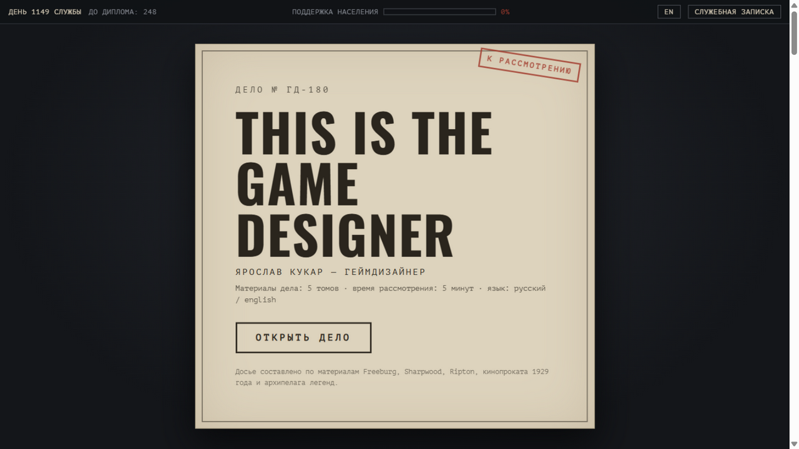
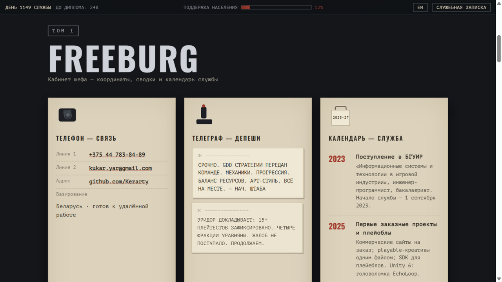
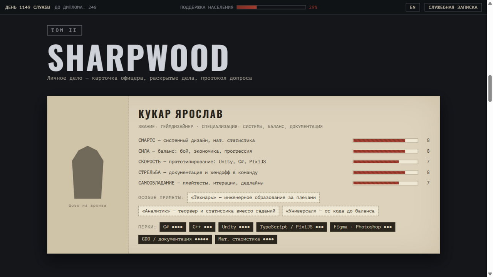
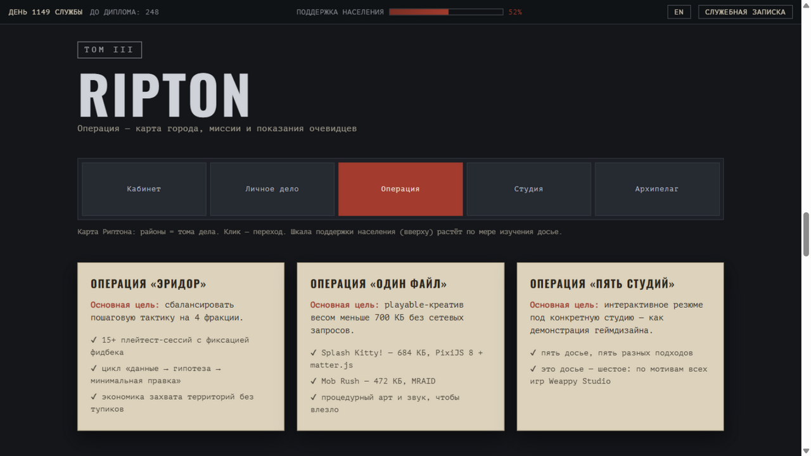
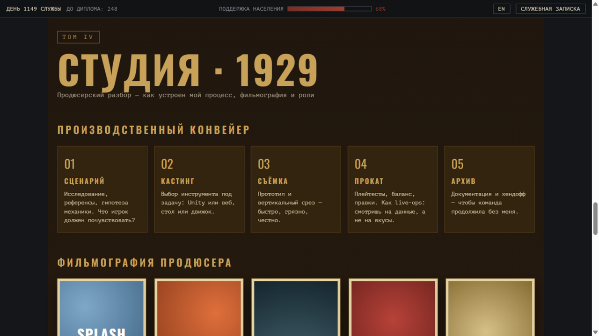
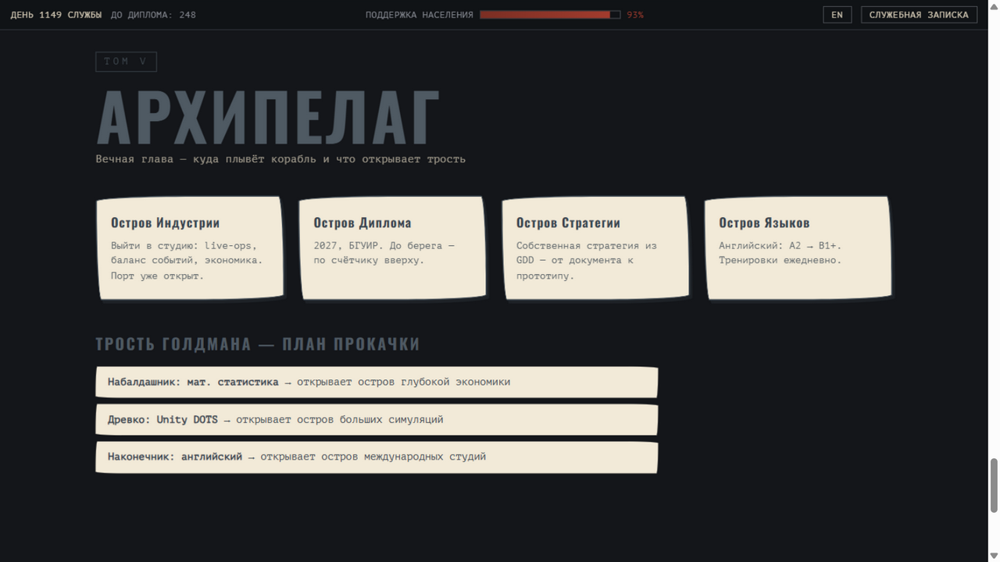

# THIS IS THE GAME DESIGNER

Моё интерактивное резюме-досье для Weappy Studio. Вместо очередного PDF — игра по мотивам всех пяти игр студии: рекрутер открывает дело № ГД-180 и листает пять томов, от кабинета шефа в Freeburg до рукописного архипелага Goldman.

Живая версия: https://kerarty.github.io/cv-weappy/



## Зачем

Обычное резюме геймдизайнера не показывает, что ты умеешь проектировать опыт. А это досье — само по себе дизайнерское решение: механика каждой игры Weappy несёт конкретный тип информации о кандидате, а не просто красивый фон.

Флагман среди проектов — «Механизм», дипломная производственная симуляция завода на Unity: полный цикл от заказа до сдачи, честное качество и связанные экономики материалов, персонала и заказов.

## Как устроено

Пять томов — пять игр студии:

- **Том I. Freeburg** (This Is the Police) — кабинет шефа: телефон со связью, телеграф с депешами-достижениями, календарь службы
- **Том II. Sharpwood** (This Is the Police 2) — личное дело: карточка офицера, где хард-скиллы — это статы, софт-скиллы — трейты, стек — перки; раскрытые дела-проекты; допрос-FAQ
- **Том III. Ripton** (Rebel Cops) — операция: карта города как навигация, миссии с целями, показания очевидцев с плейтестов
- **Том IV. Студия · 1929** (Hollywood Animal) — производственный конвейер моего workflow, фильмография проектов с «кассовыми сборами» и дилемма продюсера: реальный кейс баланса с двумя исходами
- **Том V. Архипелаг** (The Eternal Life of Goldman) — светлый финал: острова-цели, трость как план прокачки навыков, штамп «ГОДЕН К НАЙМУ»

Драматургия света: нуар → золотое кино → рукописный рассвет.

## Что умеет

- переключатель RU/EN (весь интерфейс, включая HUD и вердикт дилеммы)
- HUD: счётчик дней службы, обратный отсчёт до диплома, шкала поддержки населения, которая растёт по мере чтения
- интерактив: раскрытие дел, телеграммы, анимация статов, дилемма с двумя вариантами ответа, финальный штамп на 100% поддержки
- «Служебная записка» — печатная версия для тех, у кого нет пяти минут на игру

## Запуск

Статика без сборки — открыть `index.html` в браузере. Локальный сервер:

```bash
python -m http.server 8123
```

## Технологии

- HTML/CSS/JS без фреймворков и зависимостей
- Google Fonts: PT Mono + Oswald (кириллица)
- IntersectionObserver для появления блоков и анимации статов

## Скриншоты












## Планы

- добавить звук радио-диспетчера (выключен по умолчанию)
- заменить заглушки показаний очевидцев реальными цитатами плейтестеров «Эридора»
- масляный портрет вместо силуэта в карточке офицера
